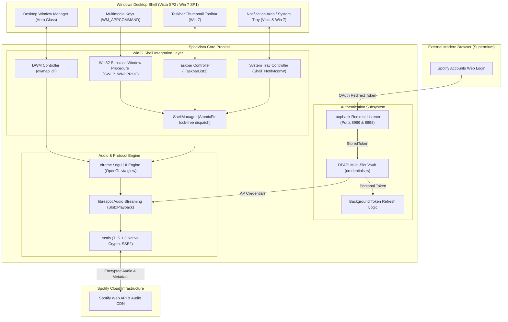

# SpotiVista: Native Spotify Client for Windows Vista and Windows 7

*   **Author:** stachustyrta
*   **Status:** Approved
*   **Date:** 2026-11-10

--------------------------------------------------------------------------------

## Overview

SpotiVista is a lightweight, native Spotify client engineered specifically for legacy Windows operating systems: Windows Vista Service Pack 2 (SP2) and Windows 7 Service Pack 1 (SP1). Forked from the Rust-based Spotifast project, SpotiVista delivers audio streaming through `librespot` without web browser runtimes (Electron/Chromium). The application integrates visually with the Windows Aero Glass aesthetic and desktop shell, provides native taskbar and notification area (System Tray) controls, supports global multimedia keys, and delegates authentication to a modern browser (such as Supermium) via local loopback PKCE redirect.

--------------------------------------------------------------------------------

## Problem Statement

Official Spotify desktop clients rely on modern Chromium and Electron frameworks that depend on Windows 10+ system APIs, leading to launch failures, high memory footprints (500 MB to 1 GB+ RAM), and high CPU utilization on legacy PC hardware.

Users maintaining Windows Vista SP2 and Windows 7 SP1 systems lack an official or lightweight way to stream audio directly from Spotify. While Spotifast provides a native Rust client for modern operating systems, its upstream build configurations, dependencies (`winit`, `projectm-sys`/MilkDrop, Discord RPC), and API assumptions prevent it from running natively on Windows Vista and 7. Furthermore, it lacks native integration with Windows NT 6.x shell features such as Windows Aero Glass composition, Taskbar Thumbnail Toolbars, and Notification Area controls.

SpotiVista addresses this gap by pruning Spotifast to its core streaming capabilities, establishing a verified build target for Windows Vista SP2 and Windows 7 SP1, and embedding native desktop shell integrations without auxiliary web servers or background polling daemons.

--------------------------------------------------------------------------------

## Goals

*   **Operating System Compatibility**: Provide native execution on Windows Vista SP2 (x86 and x64) and Windows 7 SP1 (x86 and x64) without requiring third-party kernel modifications.
*   **Aero Integration**: Implement Desktop Window Manager (DWM) glass blur effects, native-styled window borders, and high-DPI Aero-styled application icons.
*   **Native Shell Media Controls**: Implement a native Win32 Notification Area (System Tray) icon ([`TrayController`](file:///c:/SpotiVistaa/src/shell/tray.rs)) with playback controls and status tooltips for both Vista and 7, accompanied by Windows 7 Taskbar Thumbnail Toolbar controls ([`TaskbarController`](file:///c:/SpotiVistaa/src/shell/taskbar.rs)) and global multimedia key processing ([`parse_appcommand`](file:///c:/SpotiVistaa/src/shell/media_keys.rs)).
*   **Lightweight Footprint**: Remove non-essential components (MilkDrop visualizer presets and Discord Rich Presence; reject auxiliary web gadget daemons) to maintain a low working set memory footprint (~60 to 80 MB RAM) and startup under 1.5 seconds on reference dual-core hardware (Intel Core 2 Duo E6600 @ 2.40 GHz, 2 GB RAM, 7200 RPM mechanical HDD).
*   **Browser-Assisted Authentication**: Support OAuth PKCE authentication through an external modern browser (such as Supermium) via fixed loopback redirects with cryptographic `state` verification, RFC 8252 `Host` header validation, automatic background token refresh, and manual link copy fallback.

--------------------------------------------------------------------------------

## Non-Goals

*   **Support for Pre-Vista Operating Systems**: Supporting Windows XP, Windows 2000, or older versions is explicitly out of scope. Binary rejection is enforced natively by the Windows PE loader under `/SUBSYSTEM:WINDOWS,6.0` without custom launcher stubs.
*   **Built-in Web Browser / Web View**: Embedding Chromium, WebKit, or MSHTML runtimes inside SpotiVista.
*   **Visualizers and Third-Party RPC**: Re-implementing MilkDrop presets or Discord Rich Presence (retaining the native lightweight mini player spectrum analyzer in [`vis.rs`](file:///c:/SpotiVistaa/src/vis.rs)).
*   **Auxiliary Web Servers / Polling Daemons**: Adding embedded HTTP REST servers or Windows Sidebar gadget packages (Alternative B).
*   **Spotify Free Audio Playback**: Bypassing Spotify's underlying protocol limitations (playback via `librespot` requires a Spotify Premium account; Free accounts are detected and surfaced on the sign-in card via [`SignInProblem::AccountNotAllowed`](file:///c:/SpotiVistaa/src/backend.rs)).
*   **Cross-Platform Parity**: Maintaining Linux or macOS builds within this fork; SpotiVista focuses strictly on Windows Vista SP2 and Windows 7 SP1.

--------------------------------------------------------------------------------

## Resolved Architectural Decisions

*   **Toolchain and CRT Baseline**: Pinned to **Rust 1.75.0** targeting `x86_64-pc-windows-msvc` and `i686-pc-windows-msvc` with static C runtime linkage (`target-feature=+crt-static`, `/MT`). Targets baseline SSE2 instruction set (for both x86_64 and i686 targets) with software AES and SHA fallbacks to prevent invalid instruction traps on legacy Core 2 Duo processors lacking AES-NI. All codebase implementations strictly use stable Rust 1.75.0 (Edition 2021) constructs, avoiding unstable `slice_as_chunks` or `let_chains` syntax.
*   **Window Event Subclassing Lifecycle**: Win32 window message loops are hooked via `SetWindowLongPtrW` (`GWLP_WNDPROC`) on the raw window handle (`HWND`) retrieved from `eframe::CreationContext` to intercept `WM_APPCOMMAND`, `WM_COMMAND`, `WM_TASKBARBUTTONCREATED`, `WM_TRAYICON`, `WM_DWMCOMPOSITIONCHANGED`, and registered `TaskbarCreated`. To maintain lifecycle safety and prevent dangling function pointers, [`ShellManager`](file:///c:/SpotiVistaa/src/shell/mod.rs) installs in front of [`ThumbBar`](file:///c:/SpotiVistaa/src/thumbbar/win.rs), and [`Shell::drop`](file:///c:/SpotiVistaa/src/entrypoint.rs) unhooks [`ShellManager`](file:///c:/SpotiVistaa/src/shell/mod.rs) first, which restores [`ThumbBar`](file:///c:/SpotiVistaa/src/thumbbar/win.rs)'s procedure, and then [`ThumbBar::detach`](file:///c:/SpotiVistaa/src/thumbbar/win.rs) unhooks, restoring the original `winit` procedure (LIFO restoration). Message routing inside [`ShellManager`](file:///c:/SpotiVistaa/src/shell/mod.rs) uses lock-free atomic pointer reads (`AtomicPtr<ShellManager>`) to eliminate mutex contention and re-entrant deadlocks during window message dispatch.
*   **DWM Glass Composition & Opaque Panel Layout**: `eframe` is configured with `with_transparent(true)` and dynamic clear color logic. When DWM composition is active, `eframe` clear color is set to `[0.0, 0.0, 0.0, 0.0]` and Aero Glass margins are extended across the window via `DwmExtendFrameIntoClientArea` using [`Margins::FULL_WINDOW`](file:///c:/SpotiVistaa/src/shell/aero.rs) (-1). To avoid transparent text rasterization artifacts in OpenGL font rendering where antialiased glyph outlines blend against an alpha-zero framebuffer, `egui`'s central panel draws an opaque background over content areas, while headers over glass use pre-blended glyph backgrounds. When DWM composition is disabled (Vista/7 Basic mode, Safe Mode, or Remote Desktop), the clear color falls back to fully opaque `Color32::from_rgb(12, 12, 12)` (100% alpha) to eliminate basic-mode buffer smearing.
*   **Shell Integration Hierarchy**: The Win32 Notification Area icon ([`TrayController`](file:///c:/SpotiVistaa/src/shell/tray.rs)) provides universal background playback control and track info across both Windows Vista SP2 and Windows 7 SP1. Application icon resource 1 from [`spotivista.rc`](file:///c:/SpotiVistaa/res/spotivista.rc) is loaded directly from the module instance via `GetModuleHandleW`. Restoring from the notification area dispatches `Visible(true)` and `Minimized(false)` alongside Win32 `ShowWindow(hwnd, SW_RESTORE)` (when iconic) or `SW_SHOW` and `SetForegroundWindow(hwnd)`, ensuring windows started hidden (`--start-hidden` via `SW_HIDE`) become visible and focused. On Windows 7, [`TaskbarController`](file:///c:/SpotiVistaa/src/shell/taskbar.rs) Thumbnail Toolbar buttons are initialized opportunistically, while the absence of `WM_TASKBARBUTTONCREATED` on Windows Vista automatically bypasses thumbnail toolbar registration. Button clicks strictly check `HIWORD(wparam) == THBN_CLICKED` (0x1800) to avoid colliding with Win32 dialog constants.
*   **Dynamic DPI Scaling**: Thumbnail button glyphs are rendered procedurally in memory via `tiny-skia` and converted to `HICON` handles at runtime in [`win.rs`](file:///c:/SpotiVistaa/src/thumbbar/win.rs). DPI is resolved dynamically via `GetDpiForWindow` and `GetSystemMetricsForDpi` using `GetProcAddress` on Windows 10+ (checking `!user32.is_null()`), falling back to `GetSystemMetrics(SM_CXSMICON)` on Windows Vista SP2 and Windows 7 SP1 to eliminate PE loader missing entry point crashes (`0xC0000139`). Pixel transposition uses `chunks_exact_mut(4)` to guarantee Rust 1.75.0 stability.
*   **Credential Storage & Vista Limits**: Uses Spotifast's existing multi-slot credential architecture ([`credentials.rs`](file:///c:/SpotiVistaa/src/credentials.rs)) under the service name `rocks.spotivista.SpotiVista`, storing Web API tokens in [`Slot::Personal`](file:///c:/SpotiVistaa/src/credentials.rs) and librespot streaming credentials in [`Slot::Playback`](file:///c:/SpotiVistaa/src/credentials.rs). Because Windows Vista and Windows 7 Credential Manager generic credentials enforce a hard 512-byte limit on `CredentialBlobSize` (which serialized Spotify OAuth tokens exceed), Spotifast's [`WithSealedCopy`](file:///c:/SpotiVistaa/src/credentials.rs) architecture pairs [`NativeStore`](file:///c:/SpotiVistaa/src/credentials.rs) with a secondary DPAPI vault (`CryptProtectData` via [`SealedFiles`](file:///c:/SpotiVistaa/src/credentials.rs)). When [`NativeStore`](file:///c:/SpotiVistaa/src/credentials.rs) rejects tokens exceeding 512 bytes, [`WithSealedCopy`](file:///c:/SpotiVistaa/src/credentials.rs) falls back to persisting the grant via DPAPI sealed files.

--------------------------------------------------------------------------------

## Critical User Journeys (CUJs)

### CUJ 1: Initial Login and Local Playback
*   **Given**: A user running Windows 7 SP1 or Windows Vista SP2 with Supermium installed and an active Spotify Premium account.
*   **When**: The user launches SpotiVista for the first time and enters their Spotify Client ID.
*   **Then**: SpotiVista binds fixed loopback listeners (`127.0.0.1:8989/login` for Web API, `127.0.0.1:8898/login` for playback), generates a PKCE code verifier and cryptographic `state` nonce, launches the authorization URL via the default browser (with an in-app "Copy Authorization Link (for Supermium)" fallback), captures the redirect, parses HTTP headers to validate `Host: 127.0.0.1` and `state`, verifies Premium tier status in [`backend.rs`](file:///c:/SpotiVistaa/src/backend.rs), encrypts credentials via DPAPI, and begins playback on demand.

### CUJ 2: Shell Media Control on Windows 7 SP1
*   **Given**: SpotiVista is playing a track minimized or in the background on Windows 7 SP1.
*   **When**: The user hovers over the taskbar preview or presses hardware multimedia keys.
*   **Then**: The taskbar preview displays the window preview alongside interactive Previous, Play/Pause, and Next transport buttons, executing commands without bringing the window into focus. Hardware volume and media keys execute through `WM_APPCOMMAND`.

### CUJ 3: Shell Media Control on Windows Vista SP2
*   **Given**: SpotiVista is playing a track minimized to the Notification Area on Windows Vista SP2.
*   **When**: The user right-clicks the SpotiVista tray icon or hovers over it.
*   **Then**: The tray icon displays a tooltip with track title, artist, and playback status. Right-clicking displays a Win32 popup context menu with Play/Pause, Next, Previous, Open SpotiVista, and Exit options, executing playback transitions in-process. Restoring from tray un-hides and focuses the window via `SW_RESTORE` even if started with `--start-hidden`.

--------------------------------------------------------------------------------

## Proposed Architecture

SpotiVista removes upstream visualizer and Discord modules, implements an in-process Win32 shell integration layer, and utilizes loopback PKCE listeners for browser-assisted authentication.

### 1. System Architecture Diagram



### 2. Operating System Compatibility & Toolchain Runtime Layer

To execute reliably on Windows Vista SP2 (NT 6.0) and Windows 7 SP1 (NT 6.1):
*   **Toolchain Pinning & Target**: Pinned strictly to [`rust-toolchain.toml`](file:///c:/SpotiVistaa/rust-toolchain.toml) targeting `x86_64-pc-windows-msvc` and `i686-pc-windows-msvc`.
*   **Static C-Runtime Linkage**: Enforces `-C target-feature=+crt-static` (`/MT`) and `-C link-args=/SUBSYSTEM:WINDOWS,6.0 /ENTRY:mainCRTStartup` in [`config.toml`](file:///c:/SpotiVistaa/.cargo/config.toml), eliminating runtime dependencies on `ucrtbase.dll` (which is not installed by default on Windows Vista SP2).
*   **Instruction Set Baseline**: Compilation targets baseline SSE2 instruction set (for both x86_64 and i686 targets). Advanced vector and hardware acceleration flags (AVX, AES-NI) are disabled in cryptographic crates, enabling software AES and SHA fallbacks to prevent `STATUS_ILLEGAL_INSTRUCTION` traps on legacy Intel Core 2 Duo processors.
*   **Decoupled TLS Stack**: Enforces `rustls` (using `ring` with software fallbacks) across all network connections, bypassing legacy Windows `schannel.dll`.
*   **Soloist Audio Gating**: Feature `soloist-native-audio` links `ActivateAudioInterfaceAsync`, an API introduced in Windows 10 (Build 20348). This feature is removed from default features (`default = []`), preventing load-time missing symbol crashes on Windows Vista and Windows 7.

### 3. Windows Aero Glass and DWM Visual Integration

*   **Glass Extension**: The application detects if DWM composition is active via `DwmIsCompositionEnabled`. When enabled, it invokes `DwmExtendFrameIntoClientArea` using [`Margins::FULL_WINDOW`](file:///c:/SpotiVistaa/src/shell/aero.rs) (-1) to extend the glass blur across the entire client area.
*   **Clear Color and Transparency**: [`entrypoint.rs`](file:///c:/SpotiVistaa/src/entrypoint.rs) configures `eframe::NativeOptions` with `with_transparent(true)`. The `clear_color` implementation dynamically inspects `is_composition_enabled()`: returning `[0.0, 0.0, 0.0, 0.0]` when DWM composition is active. To prevent transparent text anti-aliasing artifacts where font glyphs blend against an alpha-zero framebuffer, `egui`'s central panel paints an opaque background tint over content views, while headers over glass use pre-blended glyph background rectangles. When DWM composition is disabled (Vista/7 Basic mode, Safe Mode, or Remote Desktop), `clear_color` falls back to fully opaque `Color32::from_rgb(12, 12, 12)` (100% alpha) to prevent OpenGL buffer smearing.
*   **Embedded Aero Asset Pipeline**: The project builds with a Windows `.rc` resource file ([`spotivista.rc`](file:///c:/SpotiVistaa/res/spotivista.rc)) containing a multi-resolution Aero-styled icon ([`spotivista.ico`](file:///c:/SpotiVistaa/res/spotivista.ico): 16x16, 24x24, 32x32, 48x48, 64x64, 128x128, 256x256 PNG-compressed Vista format) and transport icons.
*   **Application Manifest**: Embeds an application manifest ([`spotivista.manifest`](file:///c:/SpotiVistaa/res/spotivista.manifest)) declaring Common Controls v6.0 (`comctl32.dll`), `<dpiAware>true</dpiAware>`, and supported OS GUIDs for Windows Vista `{e2011457-1546-43c5-a5fe-008deee3d3f0}` and Windows 7 `{35138b9a-5d96-4fbd-8e2d-a2440225f93a}`.

### 4. Native Windows Shell Media Integration

*   **Notification Area (System Tray) Icon**:
    *   Creates a persistent tray icon via `Shell_NotifyIconW` (`NIM_ADD`, `NIM_MODIFY`, `NIM_DELETE`) managed by [`tray.rs`](file:///c:/SpotiVistaa/src/shell/tray.rs).
    *   Loads the application icon directly from embedded PE resource ID 1 via `GetModuleHandleW` (falling back to `GetClassLongPtrW` and `IDI_APPLICATION`).
    *   Listens for `WM_TRAYICON` (`WM_USER + 101` / `0x0465`) messages in the subclass procedure.
    *   Right-clicking displays an interactive Win32 popup menu (`TrackPopupMenuEx`) providing Play/Pause, Next Track, Previous Track, Open SpotiVista, and Exit actions.
    *   Left-clicking or double-clicking restores and focuses the main window by dispatching `egui::ViewportCommand::Visible(true)` and `Minimized(false)`, accompanied by Win32 `ShowWindow(hwnd, SW_RESTORE)` (when iconic) or `SW_SHOW` and `SetForegroundWindow(hwnd)` so windows started hidden (`--start-hidden` via `SW_HIDE`) become visible.
    *   Updates the hover tooltip (`szTip`) dynamically with current track title, artist, and playback state (`Track - Artist (Playing/Paused)`), using dirty-checking to avoid saturating IPC to `explorer.exe`.
    *   Handles Explorer crash recovery by registering `RegisterWindowMessageW("TaskbarCreated")` and restoring the icon automatically if `explorer.exe` restarts.
*   **Windows 7 Taskbar Thumbnail Toolbar (Opportunistic)**:
    *   Registers `WM_TASKBARBUTTONCREATED = RegisterWindowMessageW("TaskbarButtonCreated")`.
    *   On Windows Vista, `WM_TASKBARBUTTONCREATED` is never dispatched, automatically bypassing thumbnail toolbar registration.
    *   On Windows 7, receives the message, verifies `ITaskbarList3` availability via `CoCreateInstance`, and injects Previous Track ([`ID_PREVIOUS`](file:///c:/SpotiVistaa/src/thumbbar.rs) = 2), Play/Pause ([`ID_PLAY`](file:///c:/SpotiVistaa/src/thumbbar.rs) = 3), and Next Track ([`ID_NEXT`](file:///c:/SpotiVistaa/src/thumbbar.rs) = 4) buttons underneath the taskbar window preview via [`ThumbBar`](file:///c:/SpotiVistaa/src/thumbbar/win.rs).
    *   Button glyphs are drawn dynamically via `tiny-skia` based on desktop light/dark theme and scaled to DPI metrics in [`win.rs`](file:///c:/SpotiVistaa/src/thumbbar/win.rs). DPI is acquired dynamically using `GetProcAddress` on Windows 10+ (checking `!user32.is_null()`) and standard `GetSystemMetrics(SM_CXSMICON)` on Windows Vista SP2 and Windows 7 SP1.
    *   Button clicks arrive as `WM_COMMAND` with `HIWORD(wparam) == THBN_CLICKED` (0x1800) and `LOWORD(wparam)` corresponding to button command IDs 2, 3, or 4. [`TaskbarController::parse_command`](file:///c:/SpotiVistaa/src/shell/taskbar.rs) strictly verifies `HIWORD(wparam) == THBN_CLICKED` to avoid swallowing standard Win32 dialog constants (such as `IDCANCEL=2`).
*   **Global Multimedia Keys**:
    *   Captures `WM_APPCOMMAND` messages in the subclass window procedure ([`media_keys.rs`](file:///c:/SpotiVistaa/src/shell/media_keys.rs)).
    *   Extracts command IDs using `(((lparam as usize >> 16) as u32) & !FAPPCOMMAND_MASK) as u16` where `FAPPCOMMAND_MASK = 0xF000`.
    *   Handles `APPCOMMAND_MEDIA_PLAY`, `APPCOMMAND_MEDIA_PAUSE`, `APPCOMMAND_MEDIA_PLAY_PAUSE`, `APPCOMMAND_MEDIA_NEXTTRACK`, `APPCOMMAND_MEDIA_PREVIOUSTRACK`, `APPCOMMAND_MEDIA_STOP`, `APPCOMMAND_VOLUME_MUTE`, `APPCOMMAND_VOLUME_DOWN`, and `APPCOMMAND_VOLUME_UP`.
    *   [`parse_appcommand`](file:///c:/SpotiVistaa/src/shell/media_keys.rs) is stateless; debouncing against rapid repeated key events is enforced via timestamp gating in the application event queue.
    *   Returns `1` (`LRESULT`) to signal that the command was consumed.

### 5. Browser-Assisted Authentication Subsystem

*   **OAuth PKCE Flow**:
    *   Binds deterministic loopback TCP listeners: `127.0.0.1:8989/login` for personal Web API access, and `127.0.0.1:8898/login` for playback authentication, matching Spotify Developer Dashboard redirect URIs.
    *   Applies a 10-minute timeout (`LOGIN_TIMEOUT`) with a 5-second request line read limit.
    *   Parses incoming HTTP headers up to terminating `\r\n\r\n` and strictly validates that exactly one `Host:` header is present matching `127.0.0.1`, `localhost`, or `[::1]` (after stripping optional `:port`) to eliminate DNS rebinding attacks per RFC 8252 Section 8.3 and RFC 7230 Section 5.4. Rejects invalid requests with HTTP 400 Bad Request while keeping the listener open until the valid redirect arrives or the timeout expires.
    *   Generates a cryptographically random `code_verifier`, derives the PKCE `code_challenge` (SHA-256 base64url), and generates a random `state` nonce.
    *   Dispatches the Spotify authorization URL to the default browser using `ShellExecuteW`.
    *   Surfaces an in-app **"Copy Authorization Link (for Supermium)"** button in [`login.rs`](file:///c:/SpotiVistaa/src/ui/login.rs), allowing users on systems where Internet Explorer 7/8 cannot render modern Spotify login pages to paste the link into Supermium.
    *   Validates incoming `state` against the initial nonce, exchanges the authorization code for tokens, verifies that `product == "premium"` in [`backend.rs`](file:///c:/SpotiVistaa/src/backend.rs), and stores grants via [`credentials.rs`](file:///c:/SpotiVistaa/src/credentials.rs).
*   **Token Refresh Logic**:
    *   Exchanges `refresh_token` prior to the 60-minute access token expiration.
    *   If token refresh fails due to network outage, applies exponential backoff with jitter; if revoked (`invalid_grant`), transitions the UI to the logged-out state.

### 6. Pruned Dependencies & Footprint Reduction

*   **Removed Visualizer Modules**: Excises `projectm-sys`, MilkDrop preset downloaders, child process pipes, and CMake compile-time toolchains. [`milkdrop.rs`](file:///c:/SpotiVistaa/src/milkdrop.rs) is retained only for minimal frame-rate utility helpers.
*   **Removed Discord Modules**: Completely excludes Discord Rich Presence crates and background socket threads.
*   **Rejection of Network IPC Daemons**: Explicitly rejects adding auxiliary web gadget daemons or embedded REST servers, keeping all shell interactions in-process on the Win32 message loop.
*   **Resource Footprint**: Target working set memory reduced to ~60 to 80 MB RAM, eliminating CPU timer wakeups and idle polling drain.

--------------------------------------------------------------------------------

## Alternatives Considered

### Alternative A: Embedded Web Engine (CEF / WebView) for In-App Login

*   **Pros**: Provides an inline browser view for Spotify login without launching external browser windows.
*   **Cons**: Adds +100 MB to +250 MB binary size and +300 MB to +600 MB RAM overhead. Chromium discontinued Windows Vista support in Chromium 49 and Windows 7 support in Chromium 109; WebView2 does not support Windows Vista or Windows 7.
*   **Reason for Rejection**: Violates the strict lightweight footprint requirement (~60 to 80 MB RAM) and introduces unmaintainable browser engine dependencies on Windows Vista SP2.

### Alternative B: Windows Sidebar Companion Gadget via Local REST Server

*   **Pros**: Fulfills auxiliary desktop gadget presentation.
*   **Cons**:
    *   Microsoft officially deprecated and disabled Windows Sidebar gadgets in 2012 under Microsoft Security Advisory 2719662 due to critical remote code execution vulnerabilities in the gadget runtime.
    *   Legacy MSHTML (Trident) relies on SChannel, which cannot negotiate TLS 1.3 to load Spotify CDN album artwork, requiring a complex Rust-based in-app image caching proxy.
    *   Periodic 1000ms HTTP polling prevents CPU sleep states on legacy Core 2 Duo processors.
    *   Permissive loopback CORS headers expose the local REST server to drive-by cross-site request forgery (CSRF) from untrusted browser tabs.
*   **Reason for Rejection**: Deprecated host architecture, high attack surface, TLS limitations, and idle CPU wakeups. The native Win32 Notification Area (System Tray) icon provides universal, zero-network desktop control with negligible overhead across both Windows Vista and Windows 7.

### Alternative C: Windows Taskbar DeskBand

*   **Pros**: Docks directly into the Windows taskbar.
*   **Cons**: Requires implementing and registering a C++ COM DeskBand object (`IDeskBand2`). Microsoft deprecated DeskBands in Windows 7 and removed them in Windows 8+. Requires separate 32-bit and 64-bit shell DLL registrations.
*   **Reason for Rejection**: High COM registration complexity, DLL registration requirements, and removal in subsequent Windows versions.

### Alternative D: DwmEnableBlurBehindWindow vs DwmExtendFrameIntoClientArea

*   **Pros**: `DwmEnableBlurBehindWindow` allows applying Aero blur to arbitrary client regions (`HRGN`).
*   **Cons**: Requires tracking window resizing and manually recreating region handles; lacks natural frame margin integration.
*   **Reason for Rejection**: `DwmExtendFrameIntoClientArea` with [`Margins::FULL_WINDOW`](file:///c:/SpotiVistaa/src/shell/aero.rs) (-1) provides direct Aero Glass integration handled directly by DWM without region management overhead.

### Alternative E: Safe Subclassing (SetWindowSubclass vs SetWindowLongPtrW)

*   **Pros**: `SetWindowSubclass` / `DefSubclassProc` (`comctl32.dll`) automates message chain safety.
*   **Cons**: Requires linking dynamic Common Controls ordinal exports across legacy toolchains.
*   **Reason for Rejection**: `SetWindowLongPtrW(hwnd, GWLP_WNDPROC, ...)` integrates directly with `winit`/`eframe` raw window handles. Chaining fragility is mitigated by trapping `WM_NCDESTROY` and restoring procedures strictly in reverse installation order (LIFO) on [`Shell::drop`](file:///c:/SpotiVistaa/src/entrypoint.rs).

--------------------------------------------------------------------------------

## Non-Functional Requirements

### Security & Privacy
*   **In-Process Architecture**: All shell controls (Taskbar, System Tray, Multimedia Keys) execute strictly in-process on the Win32 message loop without opening local network ports, eliminating local REST attack vectors.
*   **Credential Storage**: Spotify OAuth tokens and session data are encrypted at rest using Windows DPAPI (`CryptProtectData`) managed by [`credentials.rs`](file:///c:/SpotiVistaa/src/credentials.rs) with service identity `rocks.spotivista.SpotiVista`. Due to the 512-byte limit of Credential Manager generic credentials on Vista/7, DPAPI acts as the primary persistence mechanism.
*   **OAuth Nonce Validation**: The PKCE flow enforces cryptographically secure `state` parameter validation and `Host: 127.0.0.1` header checking on loopback redirects to prevent authorization code injection and DNS rebinding.

### Performance & Latency
*   **Startup Time**: Application launch to interactive library UI executes in under 1.5 seconds on reference dual-core hardware (Intel Core 2 Duo E6600 @ 2.40 GHz, 2 GB DDR2-800 RAM, 7200 RPM mechanical HDD).
*   **Memory Footprint**: Working set memory remains between 60 MB and 80 MB RAM during continuous streaming playback.
*   **Idle CPU Utilization**: Idle CPU utilization drops to negligible levels (<0.1%) when playback is paused by eliminating busy-wait loops and polling timers.
*   **Shell Action Latency**: Shell and multimedia key response executes under 20 milliseconds.

### Compatibility & Rollback
*   **Native PE Rejection**: The PE header sets `/SUBSYSTEM:WINDOWS,6.0`. On Windows XP or older systems, the operating system PE loader rejects the binary natively without requiring secondary bootstrap stubs.
*   **DWM Composition Toggle**: Listens for `WM_DWMCOMPOSITIONCHANGED` to adapt dynamically if Aero Glass is toggled, falling back to an opaque background (`Color32::from_rgb(12, 12, 12)`) to prevent framebuffer smearing.

--------------------------------------------------------------------------------

## Risks & Mitigations

| Risk / Failure Mode | Severity | Probability | Concrete Mitigation Strategy |
| :--- | :--- | :--- | :--- |
| **Missing `ucrtbase.dll` on Clean Vista SP2** | High (Crash at launch) | High | Link static C runtime (`/MT`, `-C target-feature=+crt-static`) in [`config.toml`](file:///c:/SpotiVistaa/.cargo/config.toml); pin to Rust 1.75.0. |
| **Invalid Instruction Trap (No AES-NI)** | High (Crash 0xC000001D) | Medium | Restrict crypto crates (`ring`) to baseline SSE2 instruction set; enable software AES/SHA fallbacks for Core 2 Duo CPUs. |
| **Default Browser is Internet Explorer 7/8** | High (OAuth page fails to render) | High | Provide in-app **"Copy Authorization Link (for Supermium)"** button in [`login.rs`](file:///c:/SpotiVistaa/src/ui/login.rs) so users can paste into Supermium when default browser lacks modern TLS or JavaScript. |
| **OAuth Redirect Port Collision (8989 / 8898)** | Medium (Listener bind error) | Low | Surface clear error message on the sign-in card instructing user to identify and terminate conflicting listeners on port 8989 or 8898; listener times out after 10 minutes. |
| **Explorer Shell Crash / Restart** | Medium (Tray icon disappears) | Medium | Register `RegisterWindowMessageW("TaskbarCreated")`; re-install `Shell_NotifyIconW` tray icon automatically upon receiving broadcast. |
| **DWM Disabled / Remote Desktop Session** | Medium (Black box window artifacts) | Medium | Dynamically inspect `is_composition_enabled()`; clear with `[0.0; 4]` only when composition is active; fall back to opaque `Color32::from_rgb(12, 12, 12)` when disabled. |
| **Modal Tray Menu UI Thread Blocking** | Medium (Render loop stall) | Medium | `TrackPopupMenuEx` blocks the UI thread synchronously. Audio playback and decoding execute on background worker threads ([`backend.rs`](file:///c:/SpotiVistaa/src/backend.rs)), preventing audio underruns; crossbeam events queue safely until menu dismisses. |
| **Credential Manager 512-Byte Limit on Vista/7** | Medium (Storage failure) | High | On Vista and 7, `CREDENTIALW` generic credentials have a 512-byte limit. DPAPI (`CryptProtectData` via [`SealedFiles`](file:///c:/SpotiVistaa/src/credentials.rs)) in [`WithSealedCopy`](file:///c:/SpotiVistaa/src/credentials.rs) absorbs the failure and persists tokens (~600-900 bytes). |
| **Machine Sleep / Hibernation Token Expiration** | Medium (Stale session on wake) | Medium | Check token validity upon system resume; trigger refresh before issuing Web API requests; transition to sign-in screen if refresh token revoked (`invalid_grant`). |
| **DPAPI Decryption Failure Across Machine Moves** | Low (Corrupted session load) | Low | Trap DPAPI decryption errors in [`credentials.rs`](file:///c:/SpotiVistaa/src/credentials.rs); discard invalid token cache and prompt for re-authentication without crashing. |

--------------------------------------------------------------------------------

## Detailed Implementation Plan

### Implementation Summary Matrix

| Entity | Scope | Implementation Specification | Verification Criteria |
| :--- | :--- | :--- | :--- |
| 1. [`rust-toolchain.toml`](file:///c:/SpotiVistaa/rust-toolchain.toml) (Create) | Build, Toolchain & Resources | Pins compiler toolchain strictly to `1.75.0`. | `rustc --version` confirms 1.75.0. |
| 2. [`config.toml`](file:///c:/SpotiVistaa/.cargo/config.toml) (Create) | Build, Toolchain & Resources | Sets `/MT` static CRT, `/SUBSYSTEM:WINDOWS,6.0`, and entry point. | PE header inspection verifies Subsystem 6.00 across x86 and x64. |
| 3. [`Cargo.toml`](file:///c:/SpotiVistaa/Cargo.toml) (Modify) | Build, Toolchain & Resources | Excises `projectm-sys`, sets `default = []`, adds `windows-sys`, `winres`. | Compilation succeeds without CMake, `mmdevapi`, or `windows 0.58`. |
| 4. [`build.rs`](file:///c:/SpotiVistaa/build.rs) (Modify) | Build, Toolchain & Resources | Removes GLEW / vcpkg linking; compiles [`spotivista.rc`](file:///c:/SpotiVistaa/res/spotivista.rc) via `winres`. | Resource compilation outputs coff resource. |
| 5. [`spotivista.rc`](file:///c:/SpotiVistaa/res/spotivista.rc) (Create) | Build, Toolchain & Resources | Declares application icon 1, transport icons 101-104, manifest, and `VERSIONINFO`. | Resources embedded in binary. |
| 6. [`spotivista.manifest`](file:///c:/SpotiVistaa/res/spotivista.manifest) (Create) | Build, Toolchain & Resources | Common Controls 6.0 manifest with Vista & 7 supported OS GUIDs. | Manifest embedded as resource 1 (type 24). |
| 7. [`spotivista.ico`](file:///c:/SpotiVistaa/res/spotivista.ico) (Create) | Build, Toolchain & Resources | Multi-resolution 16x16 through 256x256 Vista Aero icon. | High-DPI icon display in Explorer and taskbar. |
| 8. [`spotifast.rs`](file:///c:/SpotiVistaa/src/spotifast.rs) (Modify) | Shell Integration | Binary target initializing COM (`COINIT_APARTMENTTHREADED`). | COM initialized before window creation. |
| 9. [`main.rs`](file:///c:/SpotiVistaa/src/main.rs) (Create) | Shell Integration | Entrypoint forwarder initializing COM. | Execution delegates to [`entrypoint::run`](file:///c:/SpotiVistaa/src/entrypoint.rs). |
| 10. [`entrypoint.rs`](file:///c:/SpotiVistaa/src/entrypoint.rs) (Modify) | Shell Integration | Wires [`ShellManager`](file:///c:/SpotiVistaa/src/shell/mod.rs), transparent viewport, dynamic clear color, LIFO unhooking. | Opaque clear color when DWM disabled; LIFO unhook. |
| 11. [`mod.rs`](file:///c:/SpotiVistaa/src/shell/mod.rs) (Create) | Shell Integration | [`ShellManager`](file:///c:/SpotiVistaa/src/shell/mod.rs) lifecycle, `GWLP_WNDPROC` hook, `AtomicPtr` lock-free dispatch. | Zero-mutex window message dispatch. |
| 12. [`aero.rs`](file:///c:/SpotiVistaa/src/shell/aero.rs) (Create) | Shell Integration | [`DwmProvider`](file:///c:/SpotiVistaa/src/shell/aero.rs) trait, dynamic `dwmapi.dll` loader, [`Margins::FULL_WINDOW`](file:///c:/SpotiVistaa/src/shell/aero.rs). | Aero blur extends across window frame. |
| 13. [`tray.rs`](file:///c:/SpotiVistaa/src/shell/tray.rs) (Create) | Shell Integration | [`TrayController`](file:///c:/SpotiVistaa/src/shell/tray.rs), `Shell_NotifyIconW`, icon resource 1, dynamic context menu. | Notification Area icon and context menu active. |
| 14. [`taskbar.rs`](file:///c:/SpotiVistaa/src/shell/taskbar.rs) (Create) | Shell Integration | [`TaskbarController`](file:///c:/SpotiVistaa/src/shell/taskbar.rs), `ITaskbarList3` COM probing, and `THBN_CLICKED` (IDs 2, 3, 4) parsing. | Buttons parse without Win32 dialog ID collisions. |
| 14b. [`win.rs`](file:///c:/SpotiVistaa/src/thumbbar/win.rs) (Modify) | Shell Integration | Dynamic DPI resolution via `GetProcAddress` and `tiny-skia` button glyph rasterization. | High-DPI icons render without PE loader export crashes. |
| 15. [`media_keys.rs`](file:///c:/SpotiVistaa/src/shell/media_keys.rs) (Create) | Shell Integration | `WM_APPCOMMAND` key parser for transport and volume controls. | Global multimedia key response. |
| 16. [`auth.rs`](file:///c:/SpotiVistaa/src/auth.rs) (Modify) | Authentication & Storage | Loopback redirect listener (8989/8898), RFC 8252 Host validation, PKCE. | Rejects non-127.0.0.1 host; completes PKCE. |
| 17. [`credentials.rs`](file:///c:/SpotiVistaa/src/credentials.rs) (Modify) | Authentication & Storage | Multi-slot DPAPI credential vault under `"rocks.spotivista.SpotiVista"`. | DPAPI encrypt/decrypt round-trip succeeds. |
| 18. [`login.rs`](file:///c:/SpotiVistaa/src/ui/login.rs) (Modify) | Authentication & Storage | Adds "Copy Authorization Link (for Supermium)" button and instructions. | Link copies to clipboard for external browser. |
| 19. [`paths.rs`](file:///c:/SpotiVistaa/src/paths.rs) (Modify) | Authentication & Storage | Updates data storage directories to `%APPDATA%\spotivista`. | Files stored in `%APPDATA%\spotivista`. |
| 20. [`settings.rs`](file:///c:/SpotiVistaa/src/settings.rs) (Modify) | Audio & Pruned Modules | Removes visualizer settings while retaining UI frame-rate configurations. | Frame-rate settings persist correctly. |
| 21. [`sink.rs`](file:///c:/SpotiVistaa/src/sink.rs) (Modify) | Audio & Pruned Modules | Manages rodio/fastframe-audio output pipeline without external visualizer SHM coupling. | Audio playback pipeline initializes and streams audio. |
| 22. [`vis.rs`](file:///c:/SpotiVistaa/src/vis.rs) (Modify) | Audio & Pruned Modules | Excises MilkDrop shared-memory audio rings; retains mini player spectrum. | Mini player spectrum renders post-EQ audio. |
| 23. [`milkdrop.rs`](file:///c:/SpotiVistaa/src/milkdrop.rs) (Modify) | Audio & Pruned Modules | Excises libprojectM submodules; retains minimal fps utility helpers. | Frame calculation helpers pass unit tests. |
| 24. [`README.md`](file:///c:/SpotiVistaa/README.md) (Modify) | Documentation & CI Verification | Documents SpotiVista scope, Vista/7 requirements, build and setup steps. | Clear documentation of Vista/7 native operation. |
| 25. [`ci.yml`](file:///c:/SpotiVistaa/.github/workflows/ci.yml) (Modify) | Documentation & CI Verification | Configures MSVC Windows build matrix on windows-latest with Rust 1.75.0, static CRT `/MT`, subsystem 6.0 validation, and Clippy gates. | Automated CI build and test workflows pass. |

--------------------------------------------------------------------------------

### Subsystem File Details

#### Subsystem 1: Build, Toolchain & Resources

##### 1. [`rust-toolchain.toml`](file:///c:/SpotiVistaa/rust-toolchain.toml) (Create)
*   **Scope**: Build, Toolchain & Resources
*   **Implementation Specification**:
    *   Pins channel strictly to `1.75.0` with `components = ["rustfmt", "clippy"]` to guarantee deterministic build outputs compatible with Windows NT 6.0 and NT 6.1 static CRT linking.
*   **Verification Criteria**:
    *   `rustc --version` confirms 1.75.0; toolchain installs via `rustup` without errors.

##### 2. [`config.toml`](file:///c:/SpotiVistaa/.cargo/config.toml) (Create)
*   **Scope**: Build, Toolchain & Resources
*   **Implementation Specification**:
    *   Enforces static CRT linkage (`-C target-feature=+crt-static`) and GUI subsystem parameters (`-C link-args=/SUBSYSTEM:WINDOWS,6.0 /ENTRY:mainCRTStartup`) for `x86_64-pc-windows-msvc` and `i686-pc-windows-msvc`.
*   **Verification Criteria**:
    *   PE header inspection via `dumpbin /headers` asserts Subsystem 6.00 across both 32-bit and 64-bit outputs.

##### 3. [`Cargo.toml`](file:///c:/SpotiVistaa/Cargo.toml) (Modify)
*   **Scope**: Build, Toolchain & Resources
*   **Implementation Specification**:
    *   Set `package.name = "spotivista"`, `edition = "2021"`, and `rust-version = "1.75"`.
    *   Excise `projectm-sys` and direct `glutin` visualizer dependencies; retain patched `crmne/winit` and `crmne/egui` forks under `[patch.crates-io]`.
    *   Remove unused `windows = "0.58"` crate dependency.
    *   Update `[features]` to remove `milkdrop` and set `default = []` (disabling `soloist-native-audio` which statically links Windows 10 `ActivateAudioInterfaceAsync`).
    *   Add `windows-sys = { version = "0.60", features = ["Win32_Foundation", "Win32_Graphics_Gdi", "Win32_Security_Cryptography", "Win32_System_Com", "Win32_System_LibraryLoader", "Win32_System_Registry", "Win32_System_Threading", "Win32_Globalization", "Win32_UI_Accessibility", "Win32_UI_HiDpi", "Win32_UI_Shell", "Win32_UI_WindowsAndMessaging"] }`.
    *   Add `winres = "0.1"`, `crossbeam-channel = "0.5"`, and `base64ct = { version = "1.6", features = ["alloc"] }`.
*   **Verification Criteria**:
    *   `cargo check` resolves dependencies without compilation errors or missing export warnings.

##### 4. [`build.rs`](file:///c:/SpotiVistaa/build.rs) (Modify)
*   **Scope**: Build, Toolchain & Resources
*   **Implementation Specification**:
    *   Remove all GLEW library searches, vcpkg triplet detection, and static libprojectM linking code.
    *   Compile [`spotivista.rc`](file:///c:/SpotiVistaa/res/spotivista.rc) using `winres::WindowsResource::new().set_resource_file("res/spotivista.rc").compile()`.
*   **Verification Criteria**:
    *   `cargo build` compiles Windows resources into coff resource objects.

##### 5. [`spotivista.rc`](file:///c:/SpotiVistaa/res/spotivista.rc) (Create)
*   **Scope**: Build, Toolchain & Resources
*   **Implementation Specification**:
    *   Binds application icon `1 ICON "res/spotivista.ico"`, transport icons `101 ICON "res/prev.ico"`, `102 ICON "res/play.ico"`, `103 ICON "res/pause.ico"`, `104 ICON "res/next.ico"`, manifest `1 24 "res/spotivista.manifest"`, and `VERSIONINFO`.
*   **Verification Criteria**:
    *   Resource compiler binds all icons and manifests into the final executable.

##### 6. [`spotivista.manifest`](file:///c:/SpotiVistaa/res/spotivista.manifest) (Create)
*   **Scope**: Build, Toolchain & Resources
*   **Implementation Specification**:
    *   Declares Common Controls 6.0, `<dpiAware>true</dpiAware>`, and supported OS GUIDs for Windows Vista and Windows 7.
*   **Verification Criteria**:
    *   Manifest is embedded as resource 1 (type 24) and verified via `dumpbin /headers`.

##### 7. [`spotivista.ico`](file:///c:/SpotiVistaa/res/spotivista.ico) (Create)
*   **Scope**: Build, Toolchain & Resources
*   **Implementation Specification**:
    *   Generates multi-resolution Vista PNG-compressed icon (16x16 through 256x256).
*   **Verification Criteria**:
    *   Windows Explorer and taskbar preview render high-DPI application icon correctly.

--------------------------------------------------------------------------------

#### Subsystem 2: Shell Integration

##### 8. [`spotifast.rs`](file:///c:/SpotiVistaa/src/spotifast.rs) (Modify)
*   **Scope**: Shell Integration
*   **Implementation Specification**:
    *   Initializes apartment-threaded COM via `CoInitializeEx(std::ptr::null_mut(), COINIT_APARTMENTTHREADED as u32)`.
    *   Delegates execution to [`entrypoint::run`](file:///c:/SpotiVistaa/src/entrypoint.rs).
*   **Verification Criteria**:
    *   Application initializes COM and transitions to entrypoint.

##### 9. [`main.rs`](file:///c:/SpotiVistaa/src/main.rs) (Create)
*   **Scope**: Shell Integration
*   **Implementation Specification**:
    *   Initializes apartment-threaded COM and forwards directly to [`entrypoint::run`](file:///c:/SpotiVistaa/src/entrypoint.rs).
*   **Verification Criteria**:
    *   Execution invokes [`entrypoint::run`](file:///c:/SpotiVistaa/src/entrypoint.rs) with apartment-threaded COM state active.

##### 10. [`entrypoint.rs`](file:///c:/SpotiVistaa/src/entrypoint.rs) (Modify)
*   **Scope**: Shell Integration
*   **Implementation Specification**:
    *   Instantiates [`ShellManager`](file:///c:/SpotiVistaa/src/shell/mod.rs) and attaches the main `HWND`.
    *   Configures `eframe::NativeOptions` viewport with `with_transparent(true)`.
    *   Implements dynamic `clear_color`: returns `[0.0; 4]` when `is_composition_enabled()` is true, and fully opaque `Color32::from_rgb(12, 12, 12)` (alpha 1.0) when false to eliminate Basic mode buffer smearing. In egui, the central panel draws an opaque background over content so text is not anti-aliased against transparent black.
    *   Drains [`ShellManager`](file:///c:/SpotiVistaa/src/shell/mod.rs) event receiver during UI logic passes, dispatching media, tray, taskbar, and restore actions.
    *   Restoring from tray queries `self.shell_mgr.hwnd()` and dispatches `Visible(true)` and `Minimized(false)` plus Win32 `ShowWindow(hwnd, SW_RESTORE)` (when iconic) or `SW_SHOW` and `SetForegroundWindow(hwnd)` so windows started hidden become visible and focused.
    *   Updates tray tooltip dynamically with current track and syncs state via [`ShellManager::set_playback_state`](file:///c:/SpotiVistaa/src/shell/mod.rs).
    *   [`Shell::drop`](file:///c:/SpotiVistaa/src/entrypoint.rs) unhooks `self.shell_mgr.detach()` first, then `self.thumbbar.detach()` to enforce strict LIFO window procedure unhooking and eliminate dangling pointer hazards.
*   **Verification Criteria**:
    *   Window dragging in Basic mode produces zero framebuffer ghosting; unhooking during application teardown leaves no invalid function pointer traps.

##### 11. [`mod.rs`](file:///c:/SpotiVistaa/src/shell/mod.rs) (Create)
*   **Scope**: Shell Integration
*   **Implementation Specification**:
    *   Exposes [`ShellManager`](file:///c:/SpotiVistaa/src/shell/mod.rs) holding [`LiveDwmProvider`](file:///c:/SpotiVistaa/src/shell/aero.rs), [`TrayController`](file:///c:/SpotiVistaa/src/shell/tray.rs), and [`TaskbarController`](file:///c:/SpotiVistaa/src/shell/taskbar.rs), with thread-safe playback status ([`ShellManager::set_playback_state`](file:///c:/SpotiVistaa/src/shell/mod.rs)).
    *   Registers `RegisterWindowMessageW("TaskbarCreated")` for Explorer crash recovery.
    *   Installs Win32 window procedure hook via `SetWindowLongPtrW(hwnd, GWLP_WNDPROC, window_proc)`.
    *   Uses atomic pointer read (`AtomicPtr<ShellManager>`) with `Relaxed` ordering in `window_proc`, eliminating global mutex locking and re-entrant deadlocks during high-frequency Win32 message dispatch.
    *   Handles `WM_NCDESTROY` and restores `GWLP_WNDPROC` upon `detach()` to maintain clean lifecycle semantics.
    *   Intercepts `WM_APPCOMMAND`, `WM_COMMAND`, `WM_TRAYICON`, `WM_TASKBARBUTTONCREATED`, and `WM_DWMCOMPOSITIONCHANGED`, routing events via `crossbeam_channel::unbounded()`.
*   **Verification Criteria**:
    *   `shell_manager_creates_and_routes_events` test passes; high-frequency message streams process without mutex deadlock.

##### 12. [`aero.rs`](file:///c:/SpotiVistaa/src/shell/aero.rs) (Create)
*   **Scope**: Shell Integration
*   **Implementation Specification**:
    *   Defines [`Margins`](file:///c:/SpotiVistaa/src/shell/aero.rs) struct with [`Margins::FULL_WINDOW`](file:///c:/SpotiVistaa/src/shell/aero.rs) (`-1`) and [`DwmProvider`](file:///c:/SpotiVistaa/src/shell/aero.rs) trait:
        ```rust
        pub trait DwmProvider: Send + Sync {
            fn is_composition_enabled(&self) -> bool;
            fn extend_frame_into_client_area(&self, hwnd: isize, margins: Margins) -> bool;
        }
        ```
    *   Implements [`LiveDwmProvider`](file:///c:/SpotiVistaa/src/shell/aero.rs) dynamically loading `dwmapi.dll` (`DwmIsCompositionEnabled`, `DwmExtendFrameIntoClientArea`).
*   **Verification Criteria**:
    *   `mock_dwm_tracks_margins` and `mock_dwm_disabled_fails_gracefully` tests pass.

##### 13. [`tray.rs`](file:///c:/SpotiVistaa/src/shell/tray.rs) (Create)
*   **Scope**: Shell Integration
*   **Implementation Specification**:
    *   Manages `Shell_NotifyIconW` lifecycle (`NIM_ADD`, `NIM_MODIFY`, `NIM_DELETE`) with callback message `WM_TRAYICON = WM_USER + 101`.
    *   Loads embedded icon resource 1 via `GetModuleHandleW` from the module instance, falling back to `GetClassLongPtrW` and `IDI_APPLICATION`.
    *   Implements `install`, `update_tooltip`, `remove`, and `show_context_menu`.
    *   Displays Win32 popup menu (`TrackPopupMenuEx`) with dynamic Play/Pause toggle, Next, Previous, Open SpotiVista, and Exit commands.
*   **Verification Criteria**:
    *   `encodes_tip_properly` and `truncates_long_tip` unit tests pass; tray context menu responds on target operating systems.

##### 14. [`taskbar.rs`](file:///c:/SpotiVistaa/src/shell/taskbar.rs) (Create)
*   **Scope**: Shell Integration
*   **Implementation Specification**:
    *   Registers `RegisterWindowMessageW("TaskbarButtonCreated")`.
    *   Verifies `ITaskbarList3` availability via `CoCreateInstance` (gracefully absent on Windows Vista).
    *   Parses thumbnail button clicks strictly checking `HIWORD(wparam) == THBN_CLICKED` (0x1800) matching `ID_PREVIOUS = 2`, `ID_PLAY = 3`, and `ID_NEXT = 4` to prevent swallowing standard Win32 dialog constants.
*   **Verification Criteria**:
    *   `parses_taskbar_buttons` unit test passes; notifications without `THBN_CLICKED` return `None`.

##### 14b. [`win.rs`](file:///c:/SpotiVistaa/src/thumbbar/win.rs) (Modify)
*   **Scope**: Shell Integration
*   **Implementation Specification**:
    *   Button glyphs are drawn dynamically via `tiny-skia` based on desktop light/dark theme and scaled to DPI metrics.
    *   DPI is acquired dynamically using `GetProcAddress` for `GetDpiForWindow` / `GetSystemMetricsForDpi` on Windows 10+ (checking `!user32.is_null()`) and standard `GetSystemMetrics(SM_CXSMICON)` on Windows Vista SP2 and Windows 7 SP1.
    *   Transposes pixel data using `chunks_exact_mut(4)` to ensure stable Rust 1.75.0 compilation without unstable `slice_as_chunks`.
*   **Verification Criteria**:
    *   Thumbnail toolbar renders scaled button glyphs on Windows 7 SP1; launches on Vista SP2 without `0xC0000139` entry point missing errors.

##### 15. [`media_keys.rs`](file:///c:/SpotiVistaa/src/shell/media_keys.rs) (Create)
*   **Scope**: Shell Integration
*   **Implementation Specification**:
    *   Parses `WM_APPCOMMAND` bitmask `FAPPCOMMAND_MASK = 0xF000`.
    *   Translates play/pause, stop, skip, and volume commands into [`MediaAction`](file:///c:/SpotiVistaa/src/shell/media_keys.rs) variants.
    *   [`parse_appcommand`](file:///c:/SpotiVistaa/src/shell/media_keys.rs) is stateless; debouncing against rapid repeated key events is enforced via timestamp gating in the application event queue.
*   **Verification Criteria**:
    *   `parses_media_keys` unit test passes across play, pause, next, previous, and volume commands.

--------------------------------------------------------------------------------

#### Subsystem 3: Authentication & Storage

##### 16. [`auth.rs`](file:///c:/SpotiVistaa/src/auth.rs) (Modify)
*   **Scope**: Authentication & Storage
*   **Implementation Specification**:
    *   Binds fixed loopback TCP listeners: `127.0.0.1:8989/login` (personal Web API) and `127.0.0.1:8898/login` (playback).
    *   Parses incoming HTTP headers up to terminating `\r\n\r\n` and strictly validates that exactly one `Host:` header is present matching `127.0.0.1`, `localhost`, or `[::1]` (after stripping optional `:port`) to eliminate DNS rebinding attacks per RFC 8252 Section 8.3 and RFC 7230 Section 5.4. Rejects invalid requests with HTTP 400 Bad Request while keeping the listener open until the valid redirect arrives or the timeout expires.
    *   Derives PKCE challenge from `code_verifier` (SHA-256 base64url) and verifies `state` nonce.
    *   Implements 10-minute timeout watchdog.
*   **Verification Criteria**:
    *   `rejects_dns_rebinding_host_header` test verifies HTTP 400 rejection on spoofed domains; valid loopback redirect completes code extraction.

##### 17. [`credentials.rs`](file:///c:/SpotiVistaa/src/credentials.rs) (Modify)
*   **Scope**: Authentication & Storage
*   **Implementation Specification**:
    *   Updates service identity to `const SERVICE: &str = "rocks.spotivista.SpotiVista"`.
    *   Persists credentials using dual-layer [`WithSealedCopy`](file:///c:/SpotiVistaa/src/credentials.rs) pairing [`NativeStore`](file:///c:/SpotiVistaa/src/credentials.rs) with DPAPI (`CryptProtectData` / `CryptUnprotectData` via [`SealedFiles`](file:///c:/SpotiVistaa/src/credentials.rs)), ensuring that grants exceeding Vista/7 Credential Manager's 512-byte limit persist reliably in encrypted sealed files without blocking authentication.
*   **Verification Criteria**:
    *   Token persistence round-trip test encrypts and decrypts OAuth grants without data loss.

##### 18. [`login.rs`](file:///c:/SpotiVistaa/src/ui/login.rs) (Modify)
*   **Scope**: Authentication & Storage
*   **Implementation Specification**:
    *   Adds in-app **"Copy Authorization Link (for Supermium)"** button to clipboard for users with unconfigured legacy default browsers.
*   **Verification Criteria**:
    *   Clicking button copies valid PKCE authorization URL to clipboard.

##### 19. [`paths.rs`](file:///c:/SpotiVistaa/src/paths.rs) (Modify)
*   **Scope**: Authentication & Storage
*   **Implementation Specification**:
    *   Updates application directory name and log paths to `spotivista` under `%APPDATA%\spotivista`.
*   **Verification Criteria**:
    *   Settings and cache files resolve to `%APPDATA%\spotivista`.

--------------------------------------------------------------------------------

#### Subsystem 4: Audio & Pruned Modules

##### 20. [`settings.rs`](file:///c:/SpotiVistaa/src/settings.rs) (Modify)
*   **Scope**: Audio & Pruned Modules
*   **Implementation Specification**:
    *   Removes MilkDrop child window configuration options while retaining visualizer frame rate settings for the mini player spectrum.
*   **Verification Criteria**:
    *   Settings schema deserializes without deprecated MilkDrop fields.

##### 21. [`sink.rs`](file:///c:/SpotiVistaa/src/sink.rs) (Modify)
*   **Scope**: Audio & Pruned Modules
*   **Implementation Specification**:
    *   Manages rodio/fastframe-audio output pipeline without external visualizer SHM coupling.
*   **Verification Criteria**:
    *   Audio playback pipeline initializes and streams without shared-memory buffers.

##### 22. [`vis.rs`](file:///c:/SpotiVistaa/src/vis.rs) (Modify)
*   **Scope**: Audio & Pruned Modules
*   **Implementation Specification**:
    *   Excises MilkDrop shared-memory audio rings (`shm`, `pane_shm`) and stereo recording logic behind `#[cfg(feature = "milkdrop")]`.
    *   Retains native lightweight mini player spectrum analyzer and oscilloscope.
*   **Verification Criteria**:
    *   Mini player visualizer renders post-EQ audio frames.

##### 23. [`milkdrop.rs`](file:///c:/SpotiVistaa/src/milkdrop.rs) (Modify)
*   **Scope**: Audio & Pruned Modules
*   **Implementation Specification**:
    *   Removes child, engine, and frame submodules; retains minimal fps calculation helpers ([`fps_stops`](file:///c:/SpotiVistaa/src/milkdrop.rs), [`screen_hz`](file:///c:/SpotiVistaa/src/milkdrop.rs)).
*   **Verification Criteria**:
    *   `fps_stops_match_presets` unit test passes.

--------------------------------------------------------------------------------

#### Subsystem 5: Documentation & CI Verification

##### 24. [`README.md`](file:///c:/SpotiVistaa/README.md) (Modify)
*   **Scope**: Documentation & CI Verification
*   **Implementation Specification**:
    *   Documents SpotiVista features, Vista SP2 / 7 SP1 requirements, Supermium sign-in, static CRT compilation, and build commands.
    *   Details native shell integration: Aero Glass composition, Notification Area (System Tray) controls, Taskbar Thumbnail Toolbar buttons, and multimedia hardware keys.
    *   Documents DPAPI credential storage semantics, 512-byte credential absorption, and port collision diagnostics (8989/8898).
*   **Verification Criteria**:
    *   Markdown linter passes; documentation links resolve without broken anchors.

##### 25. [`ci.yml`](file:///c:/SpotiVistaa/.github/workflows/ci.yml) (Modify)
*   **Scope**: Documentation & CI Verification
*   **Implementation Specification**:
    *   Pins GitHub Actions runner toolchain to Rust 1.75.0 (`dtolnay/rust-toolchain`).
    *   Builds `x86_64-pc-windows-msvc` and `i686-pc-windows-msvc` targets with static CRT `/MT` linkage.
    *   Executes `dumpbin /headers` validation confirming MajorOperatingSystemVersion=6 and MajorSubsystemVersion=6.
    *   Enforces `cargo test --lib` and Clippy lint validation without warnings.
*   **Verification Criteria**:
    *   CI pipeline executes to completion with green checks on Windows runner.

--------------------------------------------------------------------------------

## Verification Plan

### Compilation & Build
*   **Command**: `cargo build --release --target x86_64-pc-windows-msvc` and `cargo build --release --target i686-pc-windows-msvc`
*   **Verification**: Binary builds successfully without invoking CMake or linking against `projectm`, `mmdevapi` (`ActivateAudioInterfaceAsync`), or `windows 0.58` libraries.
*   **PE Header Inspection**: Verify with `dumpbin /headers target/x86_64-pc-windows-msvc/release/spotivista.exe` and `dumpbin /headers target/i686-pc-windows-msvc/release/spotivista.exe` that subsystem is set to Windows GUI (`subsystem (Windows GUI)` version `6.00`).
*   **Instruction Set Audit**: Disassemble crypto hot paths via `dumpbin /disasm` or run binary under an SSE2-only VM profile (Core 2 Duo without AES-NI) to confirm absence of `STATUS_ILLEGAL_INSTRUCTION` (0xC000001D).
*   **Resource Inspection**: Verify with `dumpbin /headers` or `llvm-readobj --coff-resources` that icon resource `1` and transport icons `101 through 104` are embedded.

### Unit & Schema Tests
*   **Command**: `cargo test`
*   **Coverage**:
    *   [`aero.rs`](file:///c:/SpotiVistaa/src/shell/aero.rs): `mock_dwm_tracks_margins` and `mock_dwm_disabled_fails_gracefully` tests.
    *   [`tray.rs`](file:///c:/SpotiVistaa/src/shell/tray.rs): Tooltip encoding and buffer boundary truncation tests.
    *   [`taskbar.rs`](file:///c:/SpotiVistaa/src/shell/taskbar.rs): Thumbnail button command ID parsing tests (`ID_PREVIOUS = 2`, `ID_PLAY = 3`, `ID_NEXT = 4`) and verification that `HIWORD(wparam) == THBN_CLICKED` (0x1800) is required.
    *   [`win.rs`](file:///c:/SpotiVistaa/src/thumbbar/win.rs): High-DPI icon rasterization, BGRA pixel transposition, and window procedure message routing.
    *   [`media_keys.rs`](file:///c:/SpotiVistaa/src/shell/media_keys.rs): `WM_APPCOMMAND` parsing and bitmask tests.
    *   [`mod.rs`](file:///c:/SpotiVistaa/src/shell/mod.rs): `ShellManager` event dispatching and playback state tracking tests.
    *   [`auth.rs`](file:///c:/SpotiVistaa/src/auth.rs): PKCE challenge derivation (SHA-256 base64url), loopback request line parsing, RFC 8252 exact host validation (rejecting DNS rebinding domains with 400 Bad Request), and `state` nonce validation tests.
    *   [`credentials.rs`](file:///c:/SpotiVistaa/src/credentials.rs): DPAPI encryption, `WithSealedCopy` fallback, and 512-byte grant absorption.
    *   [`milkdrop.rs`](file:///c:/SpotiVistaa/src/milkdrop.rs): Screen refresh rate calculations and fps stop labeling.
    *   [`settings.rs`](file:///c:/SpotiVistaa/src/settings.rs): Settings schema serialization and deprecated field migration.
    *   [`README.md`](file:///c:/SpotiVistaa/README.md): Markdown formatting, link validities, and platform requirement accuracy.

### Non-Functional & Performance Verification
*   **Startup Time**: Execute `Measure-Command { .\spotivista.exe --benchmark-startup }` (or trace process creation to interactive UI frame via Event Tracing for Windows / Windows Performance Recorder) on reference hardware; confirm startup is under 1.5 seconds.
*   **Memory Footprint**: Monitor working set memory via Windows Task Manager / `GetProcessMemoryInfo` during 30 minutes of continuous 320 kbps streaming; verify working set remains strictly within 60 MB to 80 MB RAM.
*   **Idle CPU Utilization**: Measure CPU utilization over a 60-second window while playback is paused; confirm sustained CPU usage is under 0.1%.
*   **Shell Action Latency**: Measure timestamp delta between `WM_APPCOMMAND` / thumbnail button click reception and backend player state dispatch; verify delta is under 20 milliseconds.

### Static Analysis & Linting
*   **Command**: `cargo clippy -- -D warnings`
*   **Verification**: Clippy exits with code 0 and zero unhandled warnings.

### Integration & Shell Verification (Manual on Target OS)

#### Windows Vista SP2 Environment
1. Launch `spotivista.exe` on a clean Windows Vista SP2 VM.
2. Confirm the application opens without missing DLL symbol errors (verifying `GetDpiForWindow` and `ActivateAudioInterfaceAsync` are not statically linked).
3. Click "Log In"; copy authorization link and paste into Supermium, complete PKCE login, and confirm tokens are saved via DPAPI sealed files.
4. Confirm DWM Aero Glass blur renders translucently behind the window header and toolbar.
5. Minimize the application; confirm the SpotiVista icon appears in the Notification Area (System Tray) using embedded resource icon 1.
6. Right-click the tray icon; verify the context menu displays Play/Pause, Next, and Previous options and executes playback transitions without errors.
7. Test left-click / double-click on tray icon; verify window is restored via `SW_RESTORE` and brought to foreground even if started with `--start-hidden`.
8. Test hardware multimedia keys (Play/Pause, Skip) and verify audio responses.
9. Disable Desktop Composition (switch to Windows Vista Basic theme); verify clear color turns fully opaque (`Color32::from_rgb(12, 12, 12)`) without black smearing artifacts or crashes.
10. Terminate `explorer.exe` via Task Manager and restart it; verify SpotiVista detects `TaskbarCreated` and re-registers the Notification Area tray icon.
11. Authenticate with a Spotify Free account; verify application surfaces the informative Premium-required message on the sign-in card without crashing.

#### Windows 7 SP1 Environment
1. Launch `spotivista.exe` on a Windows 7 SP1 VM.
2. Hover over the taskbar button; verify the thumbnail window preview displays interactive Previous, Play/Pause, and Next buttons.
3. Click the thumbnail buttons; verify playback updates without window focus change and without dialog button ID collisions.
4. Test hardware multimedia keys and verify audio responses.
5. Confirm the Notification Area tray icon operates with identical menu controls.

#### Windows XP SP3 Negative Environment
1. Attempt to launch `spotivista.exe` on a clean Windows XP SP3 installation.
2. Confirm that the Windows PE loader immediately blocks execution and displays the error message: `spotivista.exe is not a valid Win32 application`.
3. Verify that the rejection occurs at the OS loader level prior to process initialization due to `/SUBSYSTEM:WINDOWS,6.0`.
